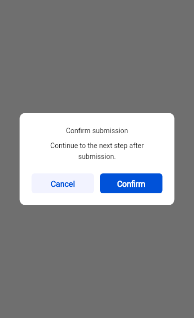
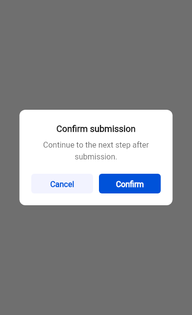

# Dialog 验证范围与结论

## 证据边界

以下归纳原记录中保留的检查点，未重新执行验收。标识、SDK或日志未完整绑定的阶段仍无法独立复现，不能将不同阶段拼成当前候选通过；细节由Git历史追溯。

## 历史检查点

| 原记录范围 | 原文可追溯标识与环境 | 有界结论 |
| --- | --- | --- |
| 既有记录 | `c345e5fbb915f2147c788ebdd5db437841f06ae4`、`ed6ac81deea5d831dabf21c2c5345c72d7dd7522`、`3583cba34fbb6d148a80b811542f30224ccb40e7`；Flutter 3.32.0 / 3.47.0 | 组件与布局：有明确通过记录（限原范围）；Demo 与消费：有明确通过记录（限原范围）；静态检查：有明确通过记录（限原范围）；Golden：有明确通过记录（限原范围）；设备：仅按下文的实际操作与未覆盖范围解释 |

## 官方场景阶段

- Flutter3.32.0/3.47.0的22个公开入口蒙层交互复核：Demo各14项，Linux3.32.0 Golden22项无更新精确通过；四方向蒙层与面板内点击分别验证。更早文案、按钮颜色及12/20/38项重跑不再逐批保存。
- Android16仅局部核对“确认类-带标题”的取消/确认配色；全部22入口的设备交互和关闭来源仍未完整复验。旧CI、拼写、CLA及PR元数据流水不作为当前状态。

## 083 · 文字槽恢复检查点

来源#1181，2026-10-21，原基线d0de29e8，随develop@a30f5770合入。以下两批均为原独立副本本地结果，不外推当前CI或设备。

| 原范围 | Flutter3.32.0 / 3.47.7非视觉结果 | Linux Flutter3.32.0 |
| --- | --- | --- |
| Dialog文字槽恢复 | 各42项组件、16项Demo、18项调度、34项TText契约；严格分析零诊断、API/文档一致，Dialog覆盖98.68% | 所属入口48项通过（含结构/交互）；Popup原4.00%/9996px差异恢复原基线，Demo前后均通过 |
| 共享Theme补充 | 各184项Theme功能、94项Dialog/TText/调度、14项Demo，严格分析零诊断；Theme覆盖分别841/868、838/868 | Theme Component27项、Theme Demo22项通过，m3_custom_content精确匹配原基线 |

共享Theme在28b0cf01曾差1.96%/6253px：无样式TText接收Dialog默认。显式设置内容内部局部主题后恢复；临时移除主题能被“期望14、实际16”断言捕获。该测试补齐没有改变生产规则；功能与Golden共用场景。

### 原基线与必要截图

| 场景 | 原差异 | 最终记录 | 基线更新 |
| --- | --- | --- | --- |
| Dialog Popup | 4.00%/9996px | 匹配原基线 | 无 |
| Theme自定义内容M2/M3 | 1.96%/6253px | 局部主题补齐后匹配原基线 | 无 |

| 修复前实际渲染 | 修复后实际渲染 |
| --- | --- |
|  |  |

截图为同环境实际渲染证据，不是Golden基线。文字槽阶段没有验证全57组件、设备或APK/Web/iOS；测试数不等于PNG数，既有快照不覆盖所有TText用法。

当前待办见 [tasks.md](./tasks.md)；实际执行入口见[贡献规范](../../../CONTRIBUTING.md#组件测试与-ci-回归门禁)。
